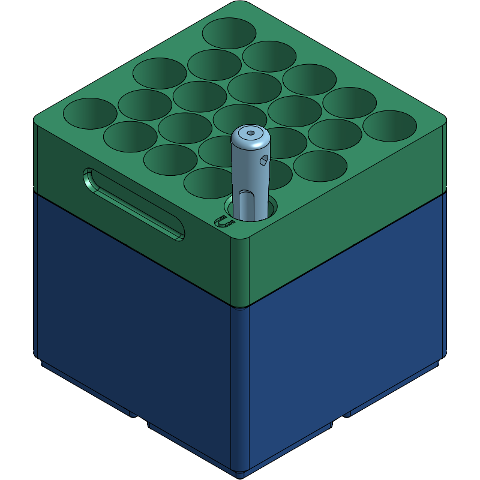
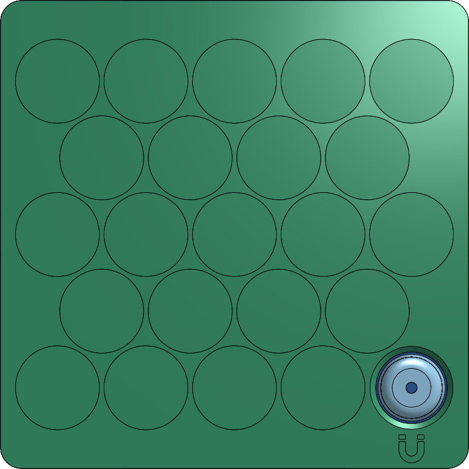

# Gridfinity AA Compact (`2×2` Stackable 44-AA + Magnetic Grabber Holder)

Parametric Onshape FeatureScript generator and verification suite for a compact, two-tier **`2×2` Gridfinity AA battery holder** (`83.5 × 83.5 mm` footprint) designed for shallow drawers (`121 mm` vertical clearance). Together, the stacked **Bottom Bin (`8U`)** and **Top Bin (`4U`)** hold **44 AA batteries** (22 per bin) in a high-density `5-4-5-4-5` honeycomb layout, plus a dedicated front-right corner slot for a cylindrical **magnetic battery grabber**.

<p align="center">
  
  
</p>

## Onshape CAD Models

- **[Gridfinity AA Compact — Bins (`AA Battery Holder Bins`)](https://cad.onshape.com/documents/b5b3469743d50b565ee40c26/w/0474acc4041cedb16334c819/e/3877013e0cee0529c7476669)** — Part Studio containing the `Bottom Bin` (`8U`) and `Top Bin` (`4U`), generated by the `Gridfinity AA Holder Generator` Feature Studio.
- **[Gridfinity AA Compact — Battery Grabber (`Battery Grabber`)](https://cad.onshape.com/documents/b5b3469743d50b565ee40c26/w/0474acc4041cedb16334c819/e/508eaf072ebbed32aa268506)** — Integrated Part Studio containing the parametric magnetic retrieval tool (`Main Body`, `Ø12.0 × 105.0 mm`) and breakaway 3D print supports (`Support Fins`) ([standalone source doc](https://cad.onshape.com/documents/c8113e21846b3e243f4047b0/w/85c21653a7b2a35730264c4a/e/efc09f3688cba75a14ed5637)).
- **[Gridfinity AA Compact — Complete Assembly (`AA Battery Holder Assembly`)](https://cad.onshape.com/documents/b5b3469743d50b565ee40c26/w/0474acc4041cedb16334c819/e/84c8a0fd2b9361f75c2d3a37)** — Complete assembly with `Bottom Bin`, `Top Bin`, and the `Battery Grabber` `Main Body` seated in its front-right corner slot.

## Key Features & Dimensions

- **`2×2` Gridfinity Footprint:** `83.50 × 83.50 mm` (`R3.75 mm` corners) with plain solid `2×2` Gridfinity feet (`4.75 mm` foot height, `42.00 mm` grid pitch).
- **`5-4-5-4-5` Honeycomb Layout (23 Slots per Bin):**
  - **22 × AA Battery Pockets (`Ø15.00 mm`):** Sized with `+0.62 mm` clearance over `Ø14.38 mm` max AA cells (Rayovac Fusion Alkaline, EBL NiMH, PowerOwl NiMH) for zero-friction vertical removal via the magnetic grabber, while maintaining a minimum `0.80 mm` inter-cell wall (`P_x = 15.80 mm`, `P_y = 13.68 mm`).
  - **1 × Corner Magnetic Grabber Slot (`Ø12.80 mm` at `X = +31.60 mm, Y = -27.36 mm`):**
    - Features a `1.00 mm × 45°` conical entry funnel (`Ø14.80 mm → Ø12.80 mm`) on both bins for self-centering.
    - Cut completely **through** the `Top Bin` (floor and foot) so the `105 mm` grabber drops straight through the `Top Bin` and seats on the `Bottom Bin` floor (`Z = 4.00 mm`), protruding `25.0 mm` above the `Top Bin` rim (`Z = 109.0 mm`).
    - **Visual Identification:** Marked by a `4.50 × 5.00 mm` debossed **U-Magnet icon** (`0.80 mm` deep) on the front-right deck of the `Top Bin`, and a concentric target ring groove (`Ø15.50–16.50 mm`, `0.80 mm` deep) on the `Bottom Bin` shoulder.
- **Vertical Stack Budget (`121 mm` Drawer Clearance):**
  - **`Bottom Bin` (`8U`):** `56.00 mm` to stacking seat + `4.40 mm` Gridfinity stacking lip (`60.40 mm` overall height; `4.00 mm` floor thickness; `50.50 mm` AA cells sit `1.50 mm` below the `56.00 mm` stacking seat).
  - **`Top Bin` (`4U` low-profile):** `28.00 mm` overall height (`Z = 56.00` to `84.00 mm` when stacked; `24.00 mm` pocket depth; `50.50 mm` AA cells reach `Z = 110.50 mm`, leaving `10.50 mm` clearance below a `121.00 mm` drawer ceiling).
  - **Ergonomic Finger-Lift Grooves:** Front and rear walls (`Y = ±41.75 mm`) of the `Top Bin` feature `40.0 × 8.0 × 2.5 mm` pill-ended (`R3.95 mm`) finger recesses with a contoured `R0.80 mm` inner back perimeter and a crisp horizontal top lifting shelf.

## Rebuilding the Model & Running Verification Tests

1. Create a `.env` file in the repository root with your Onshape API keys:
   ```ini
   ONSHAPE_ACCESS_KEY=your_access_key
   ONSHAPE_SECRET_KEY=your_secret_key
   ```
2. Set up the environment with `uv`, push the FeatureScript model to Onshape, and run the verification test suite:
   ```bash
   uv venv
   uv pip install pytest requests
   .venv/bin/python -m src.build_onshape_model
   .venv/bin/pytest -v
   ```
